# THERMOGRAPH

### AI-Based Detection and Classification of Industrial Fires and Persistent Thermal Sources Using NASA FIRMS, OSM & Satellite Data

**Smart India Hackathon 2026**  
**Problem Statement ID:** 26162  
**Theme:** Disaster Management  
**Category:** Software  
**Team:** VALKYRIES  
**Institution:** Siliguri Institute of Technology, Siliguri, West Bengal

---

## Overview

**THERMOGRAPH** is a geospatial monitoring prototype designed to turn satellite-detected thermal hotspots into location-aware and explainable information about persistent thermal activity around industrial facilities.

NASA FIRMS can detect thermal anomalies, but a hotspot by itself does not explain whether it is associated with an industrial facility, routine thermal activity, agricultural burning, or another source. THERMOGRAPH adds spatial and historical context to those observations.

The prototype focuses on one core idea:

> **Classify and monitor places, rather than treating every hotspot as an isolated event.**

The system combines:

- **NASA FIRMS / VIIRS** thermal detections
- **OpenStreetMap (OSM)** industrial facility data
- Spatial clustering and facility matching
- Historical thermal behaviour
- Baseline-based anomaly detection
- Explainable rule-based prioritisation
- GIS-based visualisation

The broader project architecture described in the technical report also allows future integration of Sentinel-2, population datasets, additional satellite sources, machine-learning classification, and targeted notifications. Those capabilities are treated as future expansion where they are not yet implemented in the prototype. fileciteturn1file2

---

## Quick Start

The entire prototype runs with two commands:

1. **Run the data processing pipeline** (loads raw FIRMS CSVs, clusters thermal sites, matches OSM facilities, builds 52-week activity history, computes 39-week baselines, detects anomalies, generates simulation, and verifies all checks C1–C15):
   ```bash
   python processing/run_pipeline.py
   ```

2. **Start the Flask API backend and interactive GIS dashboard**:
   ```bash
   python app/app.py
   ```
   Then open your browser at `http://127.0.0.1:5000/` to access the interactive map, priority anomaly sidebar, and site inspection panel.

---

Industrial facilities such as refineries, petrochemical complexes, power plants, steel plants, mining sites, and LNG terminals can produce thermal signatures that are visible from space.

A raw thermal detection does not contain enough context to determine its source. Routine industrial flaring and an unusual thermal event can therefore appear as similar observations in a basic hotspot feed.

THERMOGRAPH addresses this gap by combining:

**Thermal detection → Spatial context → Historical behaviour → Anomaly assessment → Explainable result**

This follows the system workflow described in the project presentation and technical report. fileciteturn1file9 fileciteturn1file7

---

## Prototype Scope

The current proof-of-concept is intentionally limited to a manageable geographic area and a verified historical dataset.

### Current geographic scope

**Gujarat, India**

### Current datasets

| Dataset | Current prototype data |
|---|---|
| NASA FIRMS | 12 months of Gujarat thermal detections |
| FIRMS files | 73 CSV files |
| FIRMS detections | 21,513 records |
| FIRMS period | 1 July 2025 – 30 June 2026 |
| OpenStreetMap | 710 industrial facility features |
| OSM format | GeoJSON |

The FIRMS dataset was checked for missing coordinates, missing FRP values, and duplicate rows before processing. The verified dataset contains 21,513 detections, with no missing coordinates, no missing FRP values, and no duplicate rows. fileciteturn1file0

### Why Gujarat?

The prototype uses Gujarat as a focused demonstration region. This keeps processing lightweight while providing enough industrial and thermal activity to demonstrate the complete workflow.

The architecture is designed so that the geographic coverage can be expanded later.

---

## How THERMOGRAPH Works

```mermaid
flowchart LR
    A[NASA FIRMS / VIIRS] --> B[Data Preparation]
    B --> C[Spatial Clustering]
    C --> D[Persistent Thermal Sites]
    D --> E[OSM Facility Matching]
    E --> F[Historical Baseline]
    F --> G[Anomaly Detection]
    G --> H[Explainable Risk / Priority]
    H --> I[GIS Dashboard]
```



### 1. Thermal Detection

FIRMS observations provide the initial thermal events.

A detection is treated as an observation requiring further context rather than automatically being treated as a confirmed industrial fire. This distinction is important for scientific credibility. fileciteturn1file7

### 2. Data Preparation

The raw observations are combined and checked for:

- Required fields
- Valid coordinates
- Valid FRP values
- Duplicate records
- Consistent dates and times

Raw source files remain unchanged. Processed outputs are stored separately.

### 3. Spatial Clustering

Nearby and repeatedly observed thermal detections are grouped into candidate **thermal sites**.

This is a key part of the prototype because the project is intended to build a registry of persistent thermal sources rather than display thousands of independent hotspot points.

### 4. OSM Facility Matching

Candidate thermal sites are compared with the available OSM industrial facilities.

A site can be:

- **Matched** to a nearby mapped facility
- **Unmapped / unverified** when there is no sufficiently reliable match

The system should not assign a facility identity when the available evidence does not support it. This follows the human-in-the-loop approach described in the technical report. fileciteturn1file7

### 5. Historical Baseline

For each persistent thermal site, historical observations are used to describe its normal behaviour.

The prototype uses the available **12-month dataset**. The project's original documentation describes a longer-term 10+ year baseline as a future/full-scale capability, but that historical depth is not part of the current prototype dataset. fileciteturn1file3

### 6. Anomaly Detection

A current observation is compared with the site's historical behaviour.

The prototype uses transparent statistical and rule-based logic so that the reason for an anomaly can be explained to a user.

### 7. Explainable Result

Instead of returning only a score, the system should expose the evidence behind the result, such as:

- Thermal intensity
- Detection persistence
- Baseline deviation
- Facility proximity
- Available facility context

The technical report explicitly identifies explainability and evidence-backed prioritisation as core design principles. fileciteturn1file2

### 8. GIS Dashboard

The planned dashboard presents thermal sites and their context on an interactive map.

A selected site should provide information such as:

- Location
- Facility context
- Historical activity
- Baseline
- Current observation
- Anomaly status
- Explanation for the result

---

## Prototype Intelligence

The prototype deliberately prioritises **transparent, verifiable logic**.

A labelled training dataset is not currently available for training and validating an industrial-fire classification model. Therefore, the prototype should not claim trained ML performance or fabricate model accuracy.

The current implementation direction is:

```text
Spatial evidence
       +
Thermal evidence
       +
Temporal evidence
       ↓
Rule-based assessment
       ↓
Explainable anomaly result
```

Machine-learning classification, such as an XGBoost-based classifier described in the project architecture, remains a future upgrade once suitable labelled data is available. fileciteturn1file3

---

## Technology Direction

The original technical architecture proposes Python-based processing, geospatial analysis, a Flask API, and a React/Leaflet dashboard. fileciteturn1file7

For the lightweight proof-of-concept, implementation choices may be simplified where they do not affect the scientific workflow.

| Layer | Prototype direction |
|---|---|
| Data processing | Python, Pandas |
| Spatial processing | Python geospatial calculations |
| Prototype storage | SQLite |
| Backend API | Flask |
| Map visualisation | Leaflet |
| Frontend | Lightweight web interface |
| Anomaly logic | Statistical + rule-based |
| Facility data | OpenStreetMap GeoJSON |

A production version can move to a spatial database such as PostGIS and add additional services as the data volume and operational requirements grow.

---

## Repository Structure

The repository is being developed incrementally. The intended structure is:

```text
VALKYRIES_Thermograph/
│
├── data/
│   ├── firms/                 # Raw FIRMS CSV files
│   └── osm/                   # Raw OSM facility data
│
├── processed/                 # Generated/cleaned data
│
├── src/                       # Processing and application code
│
├── dashboard/                 # Web dashboard
│
├── tests/                     # Validation tests
│
├── docs/                      # Project documentation
│
├── README.md
├── requirements.txt
└── .gitignore
```

**Note:** Raw datasets should not be modified or overwritten by processing scripts.

Large raw datasets and API credentials should also be kept out of version control where appropriate.

---

## Data Sources

### NASA FIRMS

NASA FIRMS provides satellite-based active fire and thermal anomaly observations.

Project source:

https://firms.modaps.eosdis.nasa.gov/

### OpenStreetMap

OpenStreetMap provides geographic and facility context used for spatial matching.

Project source:

https://www.openstreetmap.org/

### Sentinel-2

Sentinel-2 is identified in the project architecture as a future supporting source for higher-resolution verification and additional spatial evidence.

Project source:

https://dataspace.copernicus.eu/

The technical report lists FIRMS, Sentinel-2, OpenStreetMap, and other open datasets as part of the broader proposed system. fileciteturn1file2

---

## Scientific Credibility

THERMOGRAPH is a prototype and its results should be interpreted accordingly.

The project follows these principles:

- Do not treat every FIRMS detection as a confirmed fire.
- Do not assign a facility when the spatial evidence is insufficient.
- Do not claim ML accuracy without labelled validation data.
- Do not fabricate training results or real-world alert performance.
- Clearly identify simulated or synthetic demonstration events.
- Preserve the source information behind processed results.
- Keep raw source datasets separate from generated outputs.

These principles support the project's stated goals of contextual, explainable, and human-verifiable thermal monitoring. fileciteturn1file2

---

## Current Development Status

### Completed

- [x] FIRMS data collection for Gujarat
- [x] 12-month FIRMS dataset assembled
- [x] FIRMS data verification
- [x] OSM industrial facility dataset collected
- [x] OSM GeoJSON validation
- [x] Prototype scope defined

### In Progress

- [ ] Thermal-site clustering
- [ ] Persistent site registry
- [ ] OSM facility matching
- [ ] Per-site historical baseline
- [ ] Rule-based anomaly detection
- [ ] Explainable risk/priority logic
- [ ] Flask API
- [ ] GIS dashboard
- [ ] Demonstration workflow

### Future Expansion

- [ ] Larger historical FIRMS archive
- [ ] Sentinel-2 verification
- [ ] Population/context datasets
- [ ] Labelled training dataset
- [ ] Validated ML classification
- [ ] Automated notifications
- [ ] Multi-region / national deployment
- [ ] Production spatial database

---

## Planned End-to-End Flow

```text
FIRMS Data
    ↓
Validation & Normalisation
    ↓
Spatial + Temporal Clustering
    ↓
Persistent Thermal Sites
    ↓
OSM Facility Matching
    ↓
Historical Site Baseline
    ↓
Current Activity Comparison
    ↓
Anomaly Detection
    ↓
Explainable Priority
    ↓
GIS Dashboard
```

This workflow reflects the project's central architecture of thermal detection, facility context, historical baseline, anomaly intelligence, and decision support. fileciteturn1file2

---

## Project Goals

THERMOGRAPH aims to demonstrate that satellite thermal observations become more useful when they are connected to:

1. **Where the heat is**
2. **What is located there**
3. **How that location normally behaves**
4. **Whether the current observation is unusual**
5. **Why the system considers it important**

The prototype focuses on proving this complete path with real collected data before expanding the system with additional datasets and machine-learning capabilities.

---

## Team

**VALKYRIES**  
Siliguri Institute of Technology  
Smart India Hackathon 2026  
Problem Statement ID: **26162**

---

## References

- NASA FIRMS: https://firms.modaps.eosdis.nasa.gov/
- NASA Earthdata: https://www.earthdata.nasa.gov/
- Copernicus Data Space Ecosystem: https://dataspace.copernicus.eu/
- OpenStreetMap: https://www.openstreetmap.org/
- PostGIS Documentation: https://postgis.net/documentation/

For the project's complete technical rationale and architecture, see the accompanying technical report. fileciteturn1file2

---

## Disclaimer

THERMOGRAPH is a Smart India Hackathon prototype developed for demonstrating a geospatial approach to industrial thermal monitoring.

Prototype anomaly results are intended for demonstration and research purposes. They should not be treated as confirmed incidents or as a substitute for official investigation and verification.
